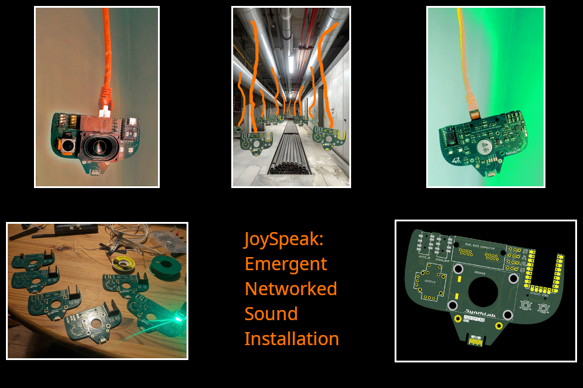

JoySpeak is an open-hardware joystick controlled speaker kit that can be hung and networked using standard RJ-45 network cables to build large-scale impromptu interactive sound installations. Sounds and gestures can be recorded on each JoySpeak that propagate through the network in unexpected ways and as new nodes are added, the character and range of interactions grows and new modes are unlocked

We plan to take this project to this year's Chaos Communication Congress (40c3) and offer kits to build at the Hardware Hacking Area there. The kit itself teaches modern surface mount soldering techniques alongside knowledge of working with audio codecs and wired networking. Once built, Model Citizen's can choose to loan their kit back to us during the congress, to increase the scale of the installation, then claim it back at the end when they need to leave (coat-check style!)

We want to explore and encourage a more communal way of working with open-hardware kits at festival and events, that are not just about buying an 'owning' an object but about building something collectively where each kit and it's builder contribute to the scope and scale of the installation throughout the event.